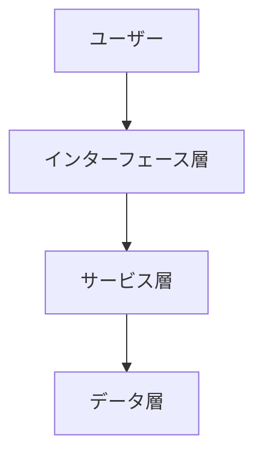
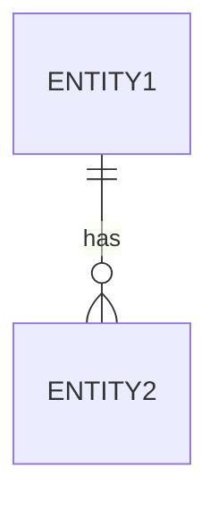
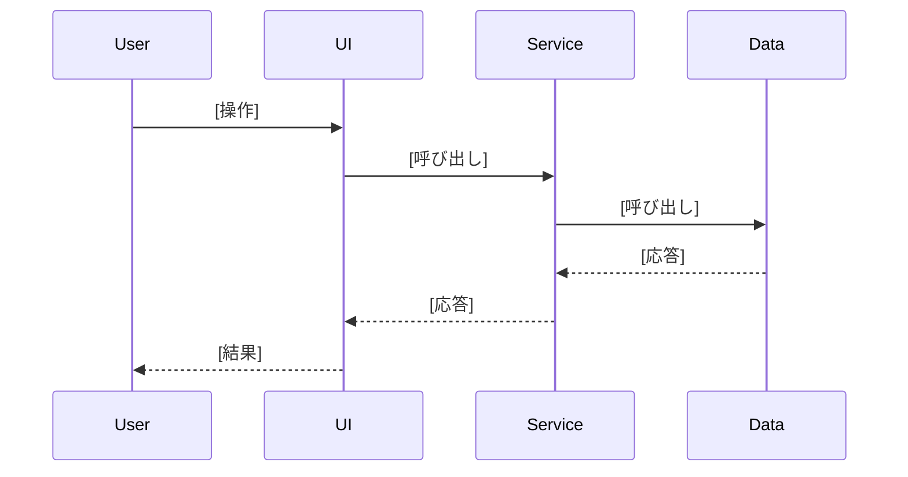
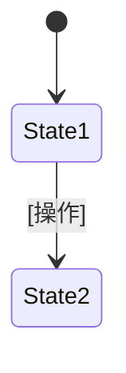

# 機能設計書 (Functional Design Document)

<!-- 該当しないセクションは削除する -->

## システム構成図



## データモデル定義

### エンティティ: [エンティティ名]

```[言語]
[プロジェクトの言語での型定義。各フィールドに制約をコメントで付ける]
```

### ER図



## コンポーネント設計

### [コンポーネント名]

- **責務**: [責務]
- **インターフェース**: [公開する関数・メソッドのシグネチャ]
- **依存先**: [依存するコンポーネント]

## ユースケース

### [ユースケース名]



## インターフェース仕様

### CLI（該当する場合）

```
[command] [options] <args>
```

| 引数・オプション | 説明 |
|---|---|
| [引数] | [説明] |

- 出力形式: [形式]
- 終了コード: [コードと意味]

### API（該当する場合）

`[METHOD] /api/[resource]`

- リクエスト: [JSON の形]
- レスポンス: [JSON の形]
- エラー: [ステータスコードと条件]

### 画面（該当する場合）



- 表示項目: [項目・フォーマット]

## アルゴリズム設計

### [アルゴリズム名]

- 目的: [説明]
- 計算: [各ステップの式・閾値・重み]
- 分類: [境界値と結果]

## データの保存形式

```
[保存先のディレクトリ構成]
```

```json
[ファイル内容の例]
```

## エラーハンドリング

| エラー種別 | 処理 | ユーザーへの表示 |
|---|---|---|
| [種別] | [処理内容] | [メッセージ] |

## テスト方針

- ユニットテスト: [対象]
- 統合テスト: [シナリオ]
- E2E テスト: [シナリオ]
