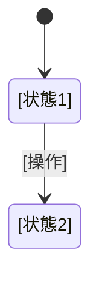

# プロジェクト用語集 (Glossary)

**更新日**: [YYYY-MM-DD]

<!-- 該当しないカテゴリは削除する。各カテゴリ内は五十音順・アルファベット順 -->

## ドメイン用語

### [用語] ([English Term])

- **定義**: [1〜2文の定義]
- **説明**: [背景・制約などの補足]（必要な場合）
- **コード上の名前**: `[型名・モジュール名]`
- **関連用語**: [用語]
- **使わない表記**: [同じ意味の別の呼び方]（ある場合）

## 状態・ステータス

### [状態の種類]

| 値 | 意味 | 遷移の条件 |
|---|---|---|
| `[値]` | [意味] | [どの操作でどの値に遷移するか] |

## エラー・例外

### [エラー名]

- **発生条件**: [条件]
- **ユーザーへの表示**: [メッセージ]
- **対処**: [ユーザーまたは開発者が取るべき対応]
- **コード上の名前**: `[エラー型名]`

## 技術用語

### [技術名]

- **定義**: [このプロジェクトでの用途]
- **バージョン**: [バージョン]

## 略語・頭字語

| 略語 | 正式名称 | 意味 |
|---|---|---|
| [略語] | [正式名称] | [意味] |
