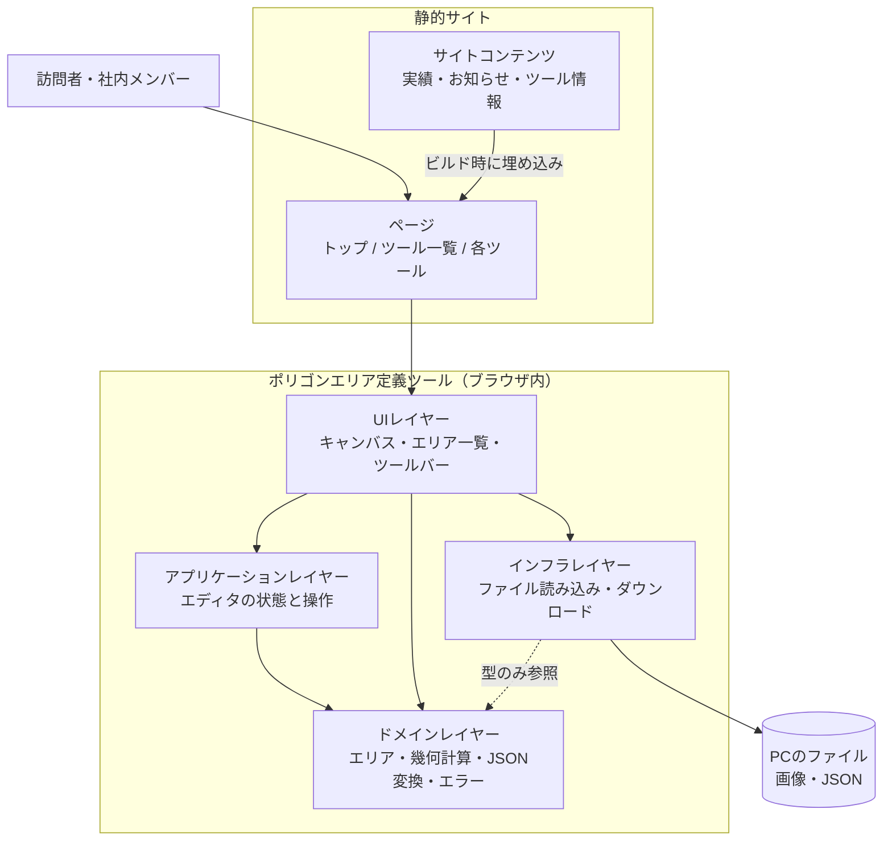
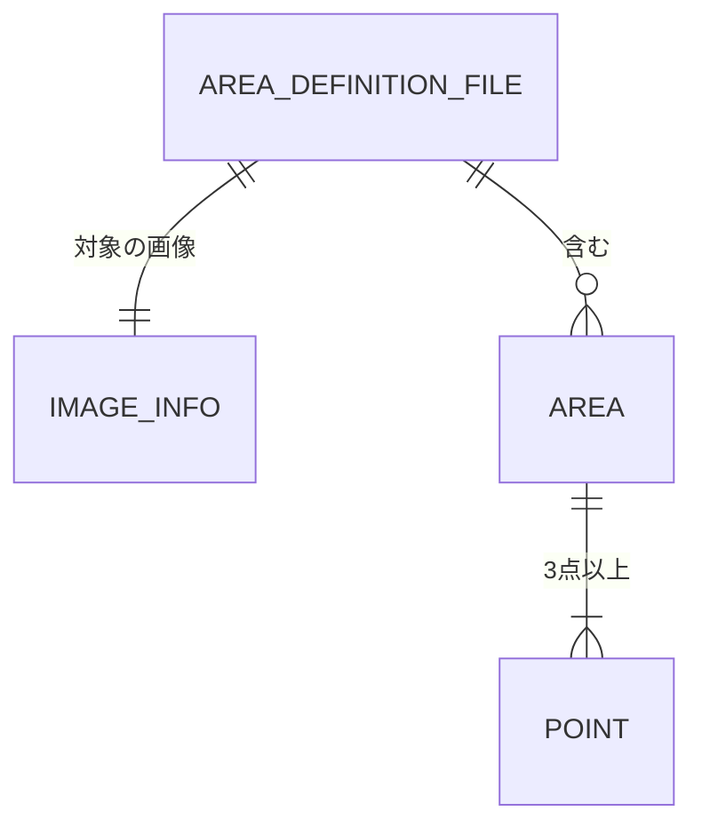
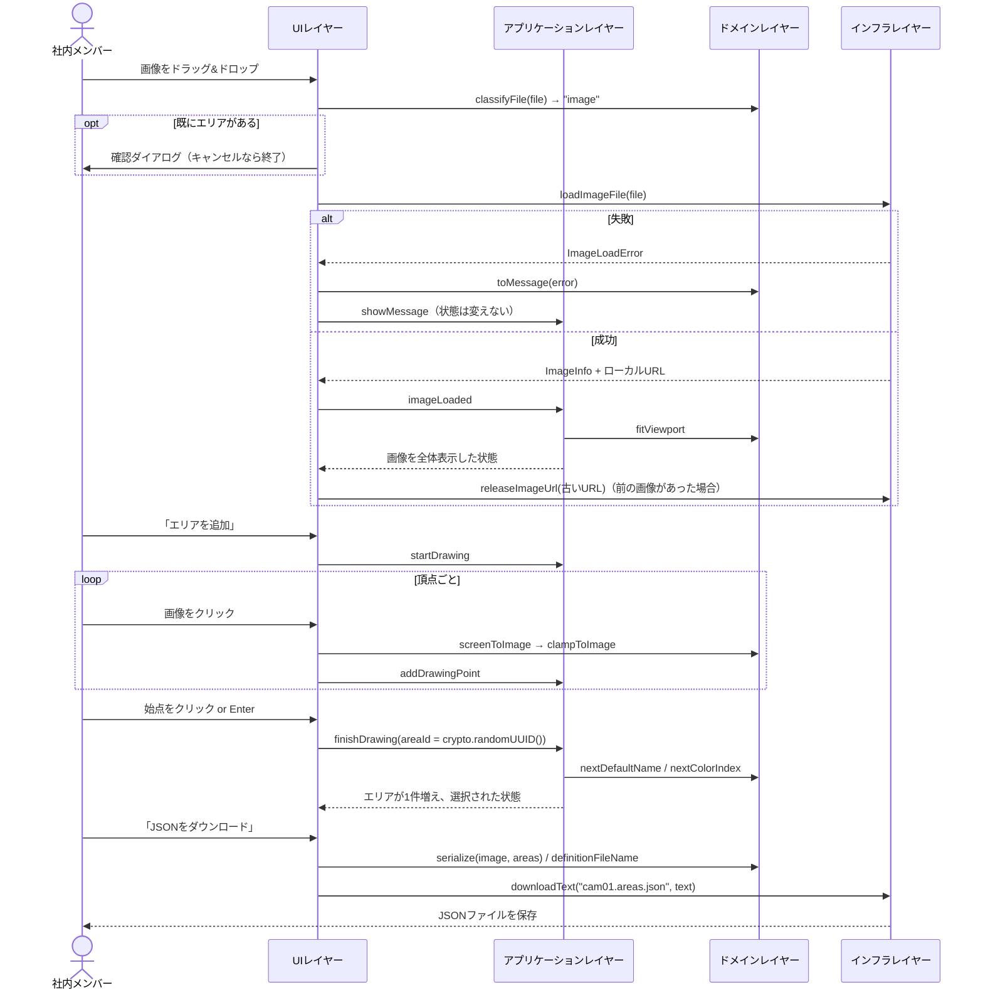
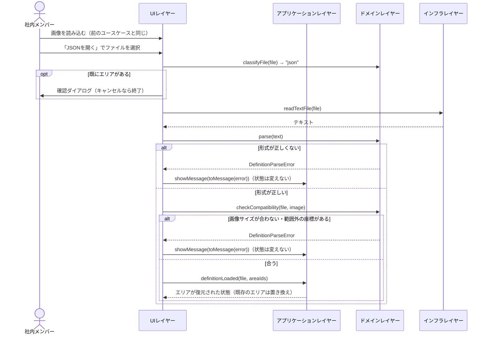
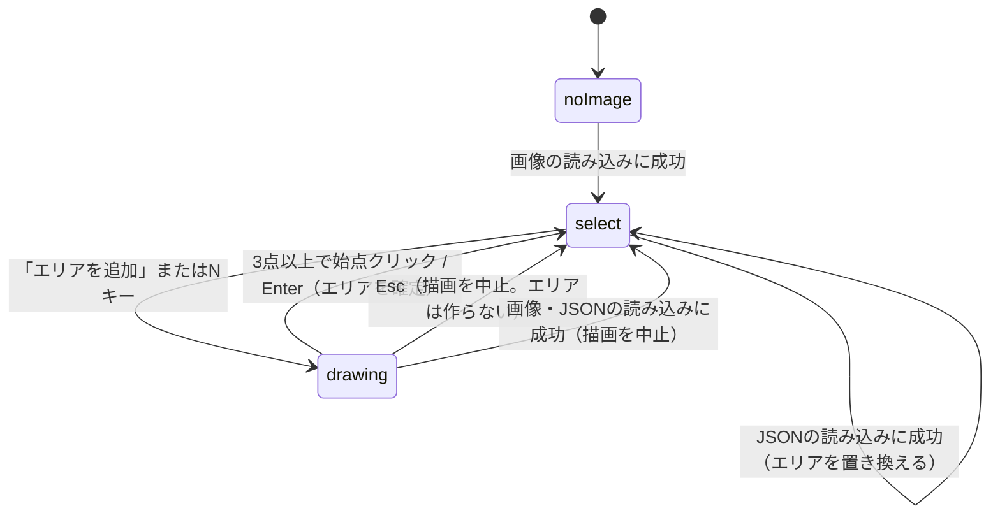

# 機能設計書 (Functional Design Document)

PRD（[product-requirements.md](product-requirements.md)）の P0 機能を、実装できる粒度に落とし込む。技術スタックは [architecture.md](architecture.md)、用語は [glossary.md](glossary.md) を参照。

## システム構成図

サーバー処理はない。ビルド時に静的なHTMLを生成し、ポリゴンエリア定義ツールはブラウザ内だけで動く。



- サイトコンテンツはビルド時にページへ埋め込む。実行時にデータを取得しない
- 読み込んだ画像とJSONは、ブラウザのメモリ上だけで扱い、外部に送信しない

## データモデル定義

### サイトコンテンツ

```typescript
/** 実績。src/content/achievements.yaml に配列で書く */
interface Achievement {
  id: string;          // 必須。小文字英数字とハイフンのみ（例: "jsai2024-demo"）。全実績で一意
  year: number;        // 必須。西暦4桁の整数（例: 2024）
  order?: number;      // 任意。0以上の整数。同じ年の中での表示順（昇順）。指定のないものは指定のあるものの後
  title: string;       // 必須。1〜100文字。例: "JSAI2024（人工知能学会全国大会）デモ出展"
  description: string; // 必須。1〜200文字。何をしたかの1文
}

/** お知らせ。src/content/news.yaml に配列で書く */
interface News {
  id: string;    // 必須。小文字英数字とハイフンのみ（例: "2026-10-site-renewal"）。全お知らせで一意
  date: string;  // 必須。YYYY-MM-DD 形式。YAML では必ずクォートして書く（例: date: "2026-10-01"。クォートしないと Date 型として読まれ、スキーマの検証でビルドが失敗する）
  title: string; // 必須。1〜100文字
  body?: string; // 任意。0〜500文字。本文がある場合のみ表示する
}

/** ツール一覧に載せるツールの情報。src/content/tools/[slug].yaml に1ツール1ファイルで書く */
interface ToolInfo {
  slug: string;        // 必須。小文字英数字とハイフンのみ（例: "polygon-area"）。YAMLには書かず、ファイル名から決まる
  name: string;        // 必須。1〜40文字。例: "ポリゴンエリア定義ツール"
  description: string; // 必須。1〜120文字。一覧に表示する短い説明
  order: number;       // 必須。0以上の整数。一覧での表示順（昇順）
}
```

- 文字数は、この文書の全ての箇所でコードポイント数（`[...text].length`）で数える

### ポリゴンエリア定義ツール: ドメインの型（`domain/types.ts`）

```typescript
/** 元画像のピクセル座標。[x, y] */
type Point = readonly [x: number, y: number];
// x: 0 以上 width - 1 以下の整数 / y: 0 以上 height - 1 以下の整数

/** 画像座標（小数を含む）。画面座標と取り違えないよう brand で区別する */
type ImagePoint = { readonly x: number; readonly y: number; readonly __brand: "ImagePoint" };

/** 画面座標（画面px = CSS ピクセル。キャンバスの左上が原点） */
type ScreenPoint = { readonly x: number; readonly y: number; readonly __brand: "ScreenPoint" };
// 作るときは imagePoint(x, y) / screenPoint(x, y) の関数を使う（同じ domain/types.ts に置く）

/** 大きさ（画面px または画像px。キャンバスの大きさと画像の大きさの両方に使う汎用の型） */
interface Size {
  readonly width: number;  // 0 以上
  readonly height: number; // 0 以上
}

/** 読み込んだ画像の情報 */
interface ImageInfo {
  readonly name: string;   // 必須。ファイル名（例: "cam01.jpg"）。1文字以上
  readonly width: number;  // 必須。1以上の整数（px）
  readonly height: number; // 必須。1以上の整数（px）
}

/** エリア。閉じたポリゴン1つ */
interface Area {
  readonly id: string;              // 必須。ツール内部の識別子。UIレイヤーが crypto.randomUUID() で作り、操作で渡す。JSONには出力しない
  readonly name: string;            // 必須。前後の空白を除いた値を保存する。1〜50文字。同じ画像の中で一意
  readonly points: readonly Point[]; // 必須。3点以上。最後の点と最初の点を結んで閉じる（最初の点を末尾に重複して持たない）
  readonly colorIndex: number;      // 必須。0〜9の整数。表示色のパレット番号。JSONには出力しない
}

/** 表示範囲。画面座標 = 画像座標 × scale + offset */
interface Viewport {
  readonly scale: number;   // 0.05 以上 32 以下
  readonly offsetX: number; // 画面px
  readonly offsetY: number; // 画面px
}

/** エリア定義JSONのファイル形式（出力・読み込みの両方で使う） */
interface AreaDefinitionFile {
  readonly version: 1;          // 必須。形式のバージョン。現在は 1 のみ
  readonly image: ImageInfo;    // 必須
  readonly areas: readonly {
    readonly name: string;                   // Area.name と同じ制約
    readonly points: readonly Point[];       // Area.points と同じ制約
  }[];                          // 必須。0件以上
}

/** 画面に表示する通知 */
interface Message {
  readonly level: "info" | "error";
  readonly text: string;
}

type Result<T, E> = { readonly ok: true; readonly value: T } | { readonly ok: false; readonly error: E };
```

- 自己交差するポリゴン、同じ座標の頂点、一直線上に並ぶ頂点は、作成時もJSONの読み込み時も許可する（内外判定は偶奇規則で行う）

### ポリゴンエリア定義ツール: エラーの型（`domain/errors.ts`）

全てのエラーの型と、表示する文言を作る関数 `toMessage` をここに置く。文言の一覧は「エラーハンドリング」を参照。

```typescript
type ImageLoadError =
  | { readonly kind: "unsupported" }   // type が image/png・image/jpeg・image/webp・image/gif・image/bmp 以外の画像（image/tiff・image/heic・image/svg+xml など）
  | { readonly kind: "decodeFailed" }; // デコードに失敗した、またはデコードできても naturalWidth・naturalHeight が 0

type FileReadError = { readonly kind: "readFailed" };

type DefinitionParseError =
  | { readonly kind: "invalidJson" }
  | { readonly kind: "unsupportedVersion"; readonly version: number } // version が数値で 1 以外
  | { readonly kind: "invalidField"; readonly path: string }          // path の例: "areas[1].points"。最上位がオブジェクトでないときは ""
  | { readonly kind: "duplicateName"; readonly name: string }
  | { readonly kind: "imageSizeMismatch"; readonly json: Size; readonly image: Size }
  | { readonly kind: "pointOutOfRange"; readonly path: string };      // path の例: "areas[0].points[2]"

type AreaNameError =
  | { readonly kind: "empty" }
  | { readonly kind: "tooLong" }
  | { readonly kind: "duplicate" };

/** reduce が操作の前提を確かめるときのエラー */
type EditOperationError =
  | { readonly kind: "tooFewPointsToFinish" }  // 2点以下で確定しようとした（Enter、または始点のクリック）
  | { readonly kind: "minimumPointsRequired" }; // 3点のエリアから頂点を削除しようとした

/** ファイルの振り分けで起きるエラー */
type FileDropError =
  | { readonly kind: "unknownFileType" }      // 画像でもJSONでもない
  | { readonly kind: "imageRequiredFirst" };  // 画像の未読み込み時にJSONを読み込もうとした

type ToolError = ImageLoadError | FileReadError | DefinitionParseError | AreaNameError | EditOperationError | FileDropError;

function toMessage(error: ToolError): Message; // level は全て "error"
```

- `ImageLoadError` と `FileReadError` はインフラレイヤーが返すが、型はドメインレイヤーに置く（インフラレイヤーはドメインの型だけを参照する）

### ポリゴンエリア定義ツール: エディタの状態（`application/editorState.ts`）

```typescript
/** エディタの状態 */
interface EditorState {
  readonly image: (ImageInfo & { readonly url: string }) | null; // url はローカルURL（blob:）
  readonly areas: readonly Area[];   // 作成順に並ぶ
  readonly mode: EditorMode;
  readonly selection: Selection;
  readonly viewport: Viewport;
  readonly message: Message | null;  // 画面に表示中の通知
}

type EditorMode =
  | { readonly kind: "noImage" }                              // 画像が未読み込み
  | { readonly kind: "select" }                               // 選択・編集
  | { readonly kind: "drawing"; readonly points: readonly Point[] }; // 新しいエリアを描画中。points は確定した頂点（0点以上）

type Selection =
  | { readonly kind: "none" }
  | { readonly kind: "area"; readonly areaId: string }
  | { readonly kind: "vertex"; readonly areaId: string; readonly index: number }; // index: 0 以上 points.length - 1 以下

/** 初期状態 */
const initialEditorState: EditorState = {
  image: null,
  areas: [],
  mode: { kind: "noImage" },
  selection: { kind: "none" },
  viewport: { scale: 1, offsetX: 0, offsetY: 0 },
  message: null,
};
```

- 「選択中のエリア」とは、`selection` が `area` のときの `areaId`、または `vertex` のときの `areaId` のエリアを指す。頂点を選択している間も、そのエリアを選択中として表示し、当たり判定の対象にする
- `EditorState` に入れないもの（カーソル位置、ホバー、ドラッグ中の一時情報、エリア名の入力中の文字列、通知を消すタイマー、操作説明の開閉）は、UIレイヤーのコンポーネントの状態として持つ。これらはJSONの出力と操作の結果に影響しない

### ER図



## コンポーネント設計

### サイト

#### 共通レイアウト（`BaseLayout`）

- **責務**: 全ページ共通の `<head>`・ヘッダー・ナビゲーション・フッター
- **インターフェース**: プロパティ `{ title?: string; description?: string }`。ページ本体を子要素として受け取る
  - `<title>`: `title` があれば `{title} | 有限会社山田田中商店`、なければ `有限会社山田田中商店`（トップページ）
  - ヘッダー: 会社名（トップページへのリンク）
  - ナビゲーション: 「トップ」→ トップページ、「ツール」→ ツール一覧ページ
  - フッター: `© {ビルドした年} 有限会社山田田中商店`
- **依存先**: `src/styles/global.css`、`withBase`（サイト内リンクの作成）

#### 部品（`src/components/`）

| 部品 | プロパティ | 表示 |
|---|---|---|
| `AchievementList` | `{ items: readonly Achievement[] }`（並べ替え済み） | 見出し「実績」と、年・タイトル・説明の一覧。0件なら見出しも含めて何も出力しない |
| `NewsList` | `{ items: readonly News[] }`（並べ替え済み） | 見出し「お知らせ」と、日付（`YYYY.MM.DD`）・タイトル・本文（ある場合）の一覧。0件なら見出しも含めて何も出力しない |
| `ToolCard` | `{ tool: ToolInfo }` | ツール名と説明。カード全体が `withBase(\`tools/${tool.slug}/\`)` へのリンク |

- 部品はコンテンツコレクションを直接読まず、ページから渡されたデータを表示するだけにする
- `.astro` ファイルでは `style` 属性と `define:vars` を使わず、クラスと CSS ファイルで見た目を書く（CSP で止められるため）

#### トップページ（`/`）

- **責務**: 会社名・事業内容・実績・お知らせの表示
- **表示する内容**:
  - 会社名: 有限会社山田田中商店
  - 事業内容（ページに直接書く）: 「顧客企業の研究開発チームに参画し、AI・DX分野の研究開発を支援しています。画像認識、生成AI、レコメンド、データ基盤などを、技術検証から本番運用まで担当します。」
  - 実績: 年の降順。同じ年は `order` の昇順（`order` のないものはその後）、それも同じなら `id` の昇順
  - お知らせ: 日付の降順。同じ日付は `id` の昇順
- **依存先**: `BaseLayout`、`AchievementList`、`NewsList`、コンテンツコレクション（`achievements`・`news`）

#### ツール一覧ページ（`/tools/`）

- **責務**: ツール情報を `order` の昇順（同じ値なら `slug` の昇順）で一覧表示する
- **依存先**: `BaseLayout`、`ToolCard`、コンテンツコレクション（`tools`）

### ポリゴンエリア定義ツール（`/tools/polygon-area/`）

#### UIレイヤー

| コンポーネント | 責務 |
|---|---|
| `PolygonAreaEditor` | ツール全体のルートコンポーネント。`EditorState` を持ち、子コンポーネントに配る。キーボード操作、ファイルのドロップの受け付けと振り分け、確認ダイアログ（`window.confirm`）、通知のタイマー、エリアの id の作成を担当する |
| `Toolbar` | 「画像を開く」「JSONを開く」「エリアを追加」「JSONをダウンロード」「全体表示」「操作説明」のボタン |
| `HelpPanel` | 操作説明。ツールバーの下に折りたたんで表示する |
| `Canvas` | 画像とエリアの表示（SVG）。クリック・ドラッグ・ホイールを受け付け、ドメインレイヤーで画像座標や当たり判定に変換してから操作を送る |
| `AreaList` | エリアの一覧（色・名前・頂点数）。選択、名前の編集、削除 |
| `StatusBar` | カーソル位置のピクセル座標、拡大率、通知の表示 |

- **依存先**: アプリケーションレイヤー、インフラレイヤー、ドメインレイヤー（座標変換・当たり判定・JSON変換・`toMessage` の呼び出し）

#### アプリケーションレイヤー

- **責務**: `EditorState` を操作（`EditorAction`）に応じて更新する。`reduce` は純粋関数で、id や時刻などの決まらない値は操作の引数で受け取る
- **検証の分担**: 画像やJSONの検証は、UIレイヤーがドメインレイヤーで行ってから、検証済みの値を `reduce` に渡す。エリア名も、UIレイヤーが確定の前に `validateAreaName` で確かめ、通ったときだけ `renameArea` を送る。`reduce` が確かめるのは操作の前提（頂点の数、エリア名の規則の二重チェック、同じピクセルの連続）だけで、満たさないときは状態を変えずに、`toMessage` で作った通知を `message` に入れる（同じピクセルの連続は通知を出さずに無視する）
- **インターフェース**:

```typescript
function reduce(state: EditorState, action: EditorAction): EditorState;

type EditorAction =
  | { type: "imageLoaded"; image: ImageInfo & { url: string }; viewportSize: Size }
  | { type: "definitionLoaded"; file: AreaDefinitionFile; areaIds: readonly string[] } // areaIds は file.areas と同じ順・同じ数
  | { type: "startDrawing" }
  | { type: "addDrawingPoint"; point: Point }
  | { type: "removeLastDrawingPoint" }
  | { type: "finishDrawing"; areaId: string }
  | { type: "cancelDrawing" }
  | { type: "select"; selection: Selection }
  | { type: "moveVertex"; areaId: string; index: number; point: Point }
  | { type: "insertVertex"; areaId: string; edgeIndex: number; point: Point } // edgeIndex 番目の頂点の後ろに挿入
  | { type: "deleteVertex"; areaId: string; index: number }
  | { type: "renameArea"; areaId: string; name: string }
  | { type: "deleteArea"; areaId: string }
  | { type: "zoom"; factor: number; anchor: ScreenPoint } // anchor を中心に拡大縮小
  | { type: "pan"; dx: number; dy: number }               // 画面px
  | { type: "fitToView"; viewportSize: Size }
  | { type: "showMessage"; message: Message }
  | { type: "dismissMessage" };
```

- **主な操作の結果**:
  - `imageLoaded`: エリアを全て消し、モードを `select`、選択を `none` にして、全体表示にする
  - `definitionLoaded`: エリアを置き換え（表示色は割り当て直す）、モードを `select`、選択を `none` にする。表示範囲は変えない
  - `startDrawing`: モードを `drawing`（頂点0点）にし、選択を `none` にする
  - `addDrawingPoint`: 直前の頂点と同じピクセルなら、状態を変えない（通知も出さない）
  - `finishDrawing`: 3点以上なら、既定の名前と表示色でエリアを追加し、そのエリアを選択して `select` に戻る。2点以下なら確定せず、エラーの通知を出す
  - `insertVertex`: 頂点を挿入し、挿入した頂点を選択する
  - `deleteVertex`・`deleteArea`: 削除した対象が選択中なら、選択を `none` にする
  - `renameArea`: 名前の規則を満たさないときは名前を変えず、`message` にエラーを入れる
- **通知を消す規則**: `zoom`・`pan`・`moveVertex`・`showMessage`・`dismissMessage` 以外の操作を受け取ったら、`message` を `null` にする（その操作自身がエラーを出す場合は、新しいエラーに置き換わる）。5秒後に消すタイマーは `PolygonAreaEditor` が持ち、通知が変わるたびに作り直して、5秒たったら `dismissMessage` を送る
- **依存先**: ドメインレイヤー

#### ドメインレイヤー

- **責務**: エリアの規則、座標変換、当たり判定、JSONとの相互変換、エラーと文言。ブラウザのAPIと外部ライブラリに依存しない
- **インターフェース**:

```typescript
// 座標変換（domain/viewport.ts）
function screenToImage(p: ScreenPoint, viewport: Viewport): ImagePoint;
function toPixel(p: ImagePoint, image: ImageInfo): Point | null; // 画像の外なら null
function clampToImage(p: ImagePoint, image: ImageInfo): Point;   // 画像の端に寄せる
function zoomAt(viewport: Viewport, factor: number, anchor: ScreenPoint): Viewport;
function wheelZoomFactor(deltaY: number, deltaMode: number): number;
function fitViewport(image: ImageInfo, viewportSize: Size): Viewport;

// 当たり判定（domain/hitTest.ts）。距離は画面px で判定する
function hitVertex(points: readonly Point[], p: ScreenPoint, viewport: Viewport): number | null; // 頂点の番号。選択中のエリアの頂点と、描画中の頂点（始点の判定）の両方に使う
function hitEdge(area: Area, p: ScreenPoint, viewport: Viewport): number | null;   // 辺の番号
function hitArea(areas: readonly Area[], p: ImagePoint): string | null;           // エリアの id。内外判定

// エリアの規則（domain/area.ts）
function normalizeAreaName(name: string): string; // 前後の空白を除く
function validateAreaName(name: string, areas: readonly Area[], selfId?: string): Result<string, AreaNameError>; // 正規化した名前を返す
function nextDefaultName(areas: readonly Area[]): string;
function nextColorIndex(areas: readonly Area[]): number;

// JSON変換（domain/definitionFile.ts）
function serialize(image: ImageInfo, areas: readonly Area[]): string; // 出力する項目だけで新しいオブジェクトを作る（url・id・colorIndex は出力しない）
function parse(text: string): Result<AreaDefinitionFile, DefinitionParseError>;
function checkCompatibility(file: AreaDefinitionFile, image: ImageInfo): Result<void, DefinitionParseError>;
function definitionFileName(imageName: string): string;

// ファイルの振り分け（domain/fileKind.ts）
function classifyFile(file: { name: string; type: string }): "image" | "json" | "unknown";

// エラー（domain/errors.ts）
function toMessage(error: ToolError): Message;
```

- **依存先**: なし

#### インフラレイヤー

- **責務**: PCのファイルの読み込み、JSONファイルの保存（ダウンロード）、ローカルURLの作成と解放。ネットワーク通信はしない
- **インターフェース**:

```typescript
function loadImageFile(file: File): Promise<Result<ImageInfo & { url: string }, ImageLoadError>>;
function readTextFile(file: File): Promise<Result<string, FileReadError>>;
function downloadText(fileName: string, text: string): void;
function releaseImageUrl(url: string): void; // URL.revokeObjectURL
```

- **依存先**: ドメインレイヤー（型のみ）。他はブラウザのAPIだけを使う

## ユースケース

### 画像を読み込んでエリアを描き、JSONをダウンロードする



### JSONを読み込んで編集を再開する



- 読み込みに失敗したとき、または確認ダイアログでキャンセルしたときは、状態を変えない（`drawing` 中なら描画を続ける）

## インターフェース仕様

### 画面一覧

| URL | 画面 | 表示項目 |
|---|---|---|
| `/` | トップページ | 会社名、事業内容、実績、お知らせ |
| `/tools/` | ツール一覧 | ツール名、説明 |
| `/tools/polygon-area/` | ポリゴンエリア定義ツール | 下記 |

- URL はサイトの `base` からの相対パス。実際のURLは `base` を前に付けたものになる（[architecture.md](architecture.md) の「公開」を参照）
- 実績・お知らせが0件のときは、その見出しごと表示しない

### ポリゴンエリア定義ツールの画面構成

```
┌──────────────────────────────────────────────────────────┐
│ ヘッダー・ナビゲーション（共通レイアウト）                         │
├──────────────────────────────────────────────────────────┤
│ [画像を開く] [JSONを開く] [エリアを追加] [JSONをダウンロード] [全体表示] [操作説明] │
├──────────────────────────────────────────────────────────┤
│ 操作説明（折りたたみ）                                          │
├─────────────────────────────────────┬────────────────────┤
│                                     │ エリア一覧           │
│         キャンバス                    │ ■ 判定エリアA 4点 [削除] │
│   （画像 + エリアのポリゴン）            │ ■ 判定エリアB 5点 [削除] │
│                                     │                    │
├─────────────────────────────────────┴────────────────────┤
│ x: 1203, y: 455   拡大率: 250%   [通知]                     │
└──────────────────────────────────────────────────────────┘
```

- **大きさ**: ツールはウィンドウの高さに収め、ページ全体はスクロールさせない。エリア一覧は幅 280px 固定。キャンバスの幅はエリア一覧を除いた残り、高さはウィンドウの高さからヘッダー・ツールバー・操作説明・ステータスバーを除いた残り（最小 400px。足りないときはページをスクロールさせてよい）
- 操作説明の開閉やウィンドウの大きさの変更でキャンバスの大きさが変わっても、表示範囲は変えない

### ツールバーのボタンの有効・無効

| ボタン | `noImage` | `select` | `drawing` |
|---|---|---|---|
| 画像を開く | 有効 | 有効 | 有効 |
| JSONを開く | 無効 | 有効 | 有効 |
| エリアを追加 | 無効 | 有効 | 無効 |
| JSONをダウンロード | 無効 | 有効 | 無効 |
| 全体表示 | 無効 | 有効 | 有効 |
| 操作説明 | 有効 | 有効 | 有効 |

- 「画像を開く」のファイル選択は `accept="image/*"`、「JSONを開く」は `accept=".json,application/json"`。選ばれたファイルは、ドロップと同じ振り分けを通す

### 操作説明

- ツールバーの下に表示する。ページを開いたときは開いた状態で、「操作説明」ボタンで開閉する（開閉の状態は保存しない）
- 内容（この順に表示する）:
  1. 画像を開く: [画像を開く] を押すか、画像をドラッグ&ドロップ
  2. エリアを描く: [エリアを追加]（N）→ 画像をクリックして頂点を置く → 始点をクリックか Enter で確定。Backspace で1つ戻す、Esc で中止
  3. 編集する: エリアをクリックして選択 → 頂点をドラッグで移動、辺をダブルクリックで頂点を追加、頂点を選んで Delete で削除。エリアを選んで Delete、またはエリア一覧の [削除] でエリアを削除。Esc で選択を解除
  4. 名前を変える: エリア一覧の名前をダブルクリック
  5. 拡大・移動: ホイールで拡大縮小、背景をドラッグか Space + ドラッグで移動、0 で全体表示
  6. 保存・再開: [JSONをダウンロード] で保存、画像を開いてから [JSONを開く] で再開

### 状態遷移



- 読み込みに失敗したとき、確認ダイアログでキャンセルしたときは、モードを変えない

### ファイルの振り分け（`classifyFile`）

ボタンで選んだファイルとドロップしたファイルを、次の順に判定する。

1. `type` が `image/` で始まる → 画像
2. 名前が `.json` で終わる（大文字小文字を区別しない）、または `type` が `application/json` → JSON
3. それ以外 → `FileDropError.unknownFileType`

- ドロップは、ツール全体（`PolygonAreaEditor` のルート要素）で受け付ける。ツールの外に落とされたファイルでブラウザがページを移らないよう、`document` の `dragover`・`drop` で `preventDefault` する
- 複数のファイルをドロップしたときは、最初の1つだけを扱い、読み込みに成功した後に info の通知「最初のファイルだけを読み込みました」を出す
- `noImage` でJSONがドロップされたときは、読み込まずに `FileDropError.imageRequiredFirst` を出す

### 操作一覧

キャンバス上の操作は、次の優先順位で対象を決める。

- `select`: 選択中のエリアの頂点 > 選択中のエリアの辺 > エリアの内側 > 背景
- `drawing`: 描画中の始点（頂点が1点以上のとき） > それ以外の場所

| 操作 | 状態 | 動作 |
|---|---|---|
| 「画像を開く」/ 画像をドロップ | 全て | 画像を読み込む。既にエリアがある場合は、確認ダイアログ「エリアは全て消えます。よろしいですか？」でOKのときだけ読み込む |
| 「JSONを開く」/ JSONをドロップ | `select`, `drawing` | JSONを読み込み、エリアを置き換える。既にエリアがある場合は、画像と同じ確認ダイアログを出す |
| 「エリアを追加」/ Nキー | `select` | `drawing` に移る |
| 左クリック（始点以外） | `drawing` | クリック位置に頂点を追加する（画像の外なら画像の端に寄せる）。直前の頂点と同じピクセルなら追加しない |
| 左ドラッグ | `drawing` | 表示位置を移動する。頂点は追加しない |
| 左クリック（始点）/ Enter | `drawing` | 3点以上なら確定する。2点以下なら確定せず（頂点も追加しない）、エラーの通知を出す |
| Backspace | `drawing` | 最後の頂点を取り消す（0点なら何もしない） |
| Esc | `drawing` | 描画を中止する |
| 左クリック（選択中のエリアの頂点） | `select` | その頂点を選択する |
| 左ドラッグ（選択中のエリアの頂点） | `select` | その頂点を選択し、移動する（画像の外には出ない） |
| 左クリック（選択中のエリアの辺） | `select` | 選択を変えない |
| ダブルクリック（選択中のエリアの辺） | `select` | その位置（`clampToImage` した点）に頂点を挿入する |
| 左クリック（エリアの内側） | `select` | そのエリアを選択する。重なっている場合は後から作ったエリアを優先する |
| 左クリック（背景） | `select` | 選択を解除する |
| 左ドラッグ（エリアの内側・背景） | `select` | 表示位置を移動する。エリアは動かさない |
| Delete / Backspace | `select`（頂点を選択中） | 頂点を削除する。3点のエリアでは削除せず、エラーの通知を出す |
| Delete / Backspace | `select`（エリアを選択中） | エリアを削除する |
| Esc | `select` | 選択を解除する |
| エリア一覧の行をクリック | `select` | そのエリアを選択する |
| エリア一覧の名前をダブルクリック | `select` | そのエリアを選択し、名前を編集する。Enter で確定する。エラーのときは、入力欄を開いたまま入力値を残し、エラーの通知を出す。フォーカスを外したときも確定するが、エラーのときは元の名前に戻して閉じ、エラーの通知を出す。Esc で元の名前に戻して閉じる |
| エリア一覧の「削除」 | `select`, `drawing` | エリアを削除する（`drawing` 中は描画を続ける） |
| マウスホイール | `select`, `drawing` | カーソル位置を中心に拡大・縮小する |
| 中ボタンドラッグ / Space + 左ドラッグ | `select`, `drawing` | 表示位置を移動する |
| 「全体表示」/ 0キー | `select`, `drawing` | 画像全体が収まる拡大率に戻す |
| 「JSONをダウンロード」 | `select` | JSONを保存する。エリアが0件でも保存できる |

- キーは `document` の `keydown` で受け取る。`input`・`textarea` にフォーカスがあるとき（エリア名の編集中など）は無視する。ツールの操作に使った Enter・Space・Backspace・Delete は `preventDefault` する（Space でのページのスクロールなどを防ぐ）
- ツールバーのボタンは、クリックした後にフォーカスを外す（ボタンにフォーカスが残ると、Enter や Space でボタンも押されるため）
- ホイールは、キャンバスに `{ passive: false }` で登録し、常に `preventDefault` する（ページのスクロールと、ピンチでのページ全体のズームを防ぐ）
- ダブルクリックは `dblclick` イベントで判定する。1回目のクリックは「左クリック（選択中のエリアの辺）」として扱われ、選択は変わらない
- 画像が未読み込みの間、キャンバスには「画像をドラッグ&ドロップするか、[画像を開く]を押してください」と表示する
- 「全体表示」は、その時点のキャンバスの大きさで計算する
- ページを離れるときの確認（`beforeunload`）は、MVP では行わない。作業はJSONのダウンロードで保存する

### 表示項目

- **座標表示**: カーソルが画像上にあるとき `x: 1203, y: 455`（`toPixel` の結果）。画像の外では `x: -, y: -`
- **拡大率**: `scale × 100` を四捨五入して整数にし、`%` で表示する
- **エリア**: 塗りは表示色の不透明度 25%、輪郭は表示色の幅 2画面px。選択中のエリアは輪郭を幅 3画面px にし、頂点ハンドルを表示する
- **頂点ハンドル**: 選択中のエリアの頂点と、描画中の頂点に表示する（それ以外のエリアの頂点には表示しない）。半径 5画面px の白い円に、表示色の枠。選択中の頂点は表示色で塗りつぶす。拡大率に関係なく同じ大きさで表示する
- **エリア名**: 最初の頂点から右上に 6画面px ずらした位置に、12画面px の文字で表示する
- **描画中**: 置いた頂点を結ぶ線と、最後の頂点からカーソルまでの仮の線を、確定したときに割り当てられる表示色（`nextColorIndex`）で表示する。カーソルが始点の当たり判定に入ったら、始点のハンドルを半径 7画面px にして強調する

### JSONの出力

- **ファイル名**: 画像のファイル名の最後の `.` から後ろを除き、`.areas.json` を付ける（例: `cam01.jpg` → `cam01.areas.json`、`a.b.png` → `a.b.areas.json`）。`.` を含まないか、先頭の `.` だけのときは、そのまま `.areas.json` を付ける
- **形式**: `JSON.stringify(data, null, 2)` の出力の末尾に改行1つを付けたもの。UTF-8。`data` は、下のキーだけで新しく作ったオブジェクトにする（`EditorState.image` の `url` や、エリアの `id`・`colorIndex` を出力しない）
- **キーの順序**: `version`、`image`（`name`、`width`、`height`）、`areas`（各要素は `name`、`points`）
- **並び順**: `areas` はエリアの作成順。`points` は描いた順

```json
{
  "version": 1,
  "image": {
    "name": "cam01.jpg",
    "width": 1920,
    "height": 1080
  },
  "areas": [
    {
      "name": "判定エリアA",
      "points": [
        [
          120,
          340
        ],
        [
          860,
          320
        ],
        [
          900,
          1000
        ]
      ]
    }
  ]
}
```

## アルゴリズム設計

### 座標変換と丸め

- 目的: 画面上のマウス位置を、元画像のピクセル座標にする
- 画面座標: マウスイベントの位置から、キャンバス（SVG 要素）の `getBoundingClientRect()` の左上を引いた CSS ピクセル（`devicePixelRatio` は掛けない）
- 計算:
  1. 画像座標（小数）: `x = (screenX - offsetX) / scale`、`y = (screenY - offsetY) / scale`
  2. ピクセル座標: `px = floor(x)`、`py = floor(y)`（そのピクセルの番号。座標表示と頂点の位置で同じ値を使う）
  3. 範囲: 座標表示では、`0 ≤ px ≤ width - 1` かつ `0 ≤ py ≤ height - 1` の外なら「画像の外」とする。頂点を置く・動かすときは、この範囲に寄せる（clamp）
- 頂点の表示位置: ピクセルの中心 `(px + 0.5, py + 0.5)` に描く

### 拡大縮小

- ホイール: 1イベントごとに `factor = 1.2 ^ (-delta / 100)` を掛ける。`delta` は `deltaY` を画面px に換算した値（`deltaMode` が 0 ならそのまま、1（行単位）なら ×40、2（ページ単位）なら ×800）。マウスホイール1段階（約100画面px）でおよそ 1.2倍 になり、トラックパッドでは動かした量に比例して変わる
- トラックパッドのピンチ（`ctrlKey` 付きのホイールイベント）も同じ式で扱う
- 拡大率の範囲は 0.05〜32。範囲を超える場合は端の値で止める
- カーソル位置の画像座標が変わらないように offset を更新する: `offset' = anchor - (anchor - offset) × (scale' / scale)`
- 全体表示: `scale = min(キャンバスの幅 / width, キャンバスの高さ / height) × 0.95` を 0.05〜32 に収め、画像がキャンバスの中央に来るように offset を決める。画像を読み込んだ直後も全体表示にする

### 当たり判定

判定の距離は、拡大率に関係なく画面px で測る。優先順位は「操作一覧」の冒頭のとおり。

| 対象 | 条件 |
|---|---|
| 頂点 | 選択中のエリアの頂点のうち、表示位置との距離が 8画面px 以下のもの。複数あれば最も近い頂点（`hitVertex`） |
| 描画中の始点 | 描画中の頂点が1点以上あり、始点との距離が 8画面px 以下（`hitVertex` の結果が 0）。当たったときは頂点を追加せず、確定を試みる（2点以下ならエラーの通知） |
| 辺 | 選択中のエリアの辺（線分）との距離が 6画面px 以下。複数あれば最も近い辺 |
| エリアの内側 | ポリゴンの内外判定（偶奇規則のレイキャスティング）で内側。重なる場合は後から作ったエリア |

- クリックとドラッグの区別: 押してから離すまでの移動が 4画面px 未満ならクリック、4画面px 以上ならドラッグ

### エリア名と表示色

- 既定の名前: `エリア{n}`。`n` は1から始め、既存の名前と重ならない最小の整数
- 名前の正規化と検証: 前後の空白（`String.prototype.trim` で除かれるもの）を除いた値を、保存と比較の両方に使う。空、51文字以上（コードポイント数）、他のエリアと同じ名前（大文字小文字を区別して完全一致）はエラー
- 表示色: 10色のパレットを使う。新しいエリアには「既存のエリアで使われている回数が最も少ない色のうち、番号が最小の色」を割り当てる

| 番号 | 0 | 1 | 2 | 3 | 4 | 5 | 6 | 7 | 8 | 9 |
|---|---|---|---|---|---|---|---|---|---|---|
| 色 | `#e6194b` | `#3cb44b` | `#4363d8` | `#f58231` | `#911eb4` | `#42d4f4` | `#f032e6` | `#bfef45` | `#9a6324` | `#469990` |

- 色はJSONに出力しない。JSONを読み込んだときは、エリアの順に上の規則で割り当て直す

### JSONの検証（`parse` と `checkCompatibility`）

次の順に確認し、最初に見つかった問題をエラーにする。`invalidField` と `pointOutOfRange` の path は、問題のある一番細かい場所を指す（`i`・`j` は0から始まる番号）。

| 順 | 確認すること | エラーと path |
|---|---|---|
| 1 | JSONとして解釈できる | `invalidJson` |
| 2 | 最上位がオブジェクト（配列・null でない） | `invalidField`、`""` |
| 3 | `version` があり数値 | `invalidField`、`"version"` |
| 4 | `version` が `1` | `unsupportedVersion` |
| 5 | `image` がオブジェクト | `invalidField`、`"image"` |
| 6 | `image.name` が1文字以上の文字列 → `image.width` → `image.height` が1以上の整数（この順） | `invalidField`、`"image.name"`・`"image.width"`・`"image.height"` |
| 7 | `areas` が配列 | `invalidField`、`"areas"` |
| 8 | 要素ごとに、`i` の小さい順に: 要素がオブジェクト → `name` が文字列で、正規化した名前が空でなく50文字以内 → `points` が3点以上の配列 → 各点（`j` の小さい順）が2つの整数の配列 | `invalidField`、`"areas[i]"`・`"areas[i].name"`・`"areas[i].points"`・`"areas[i].points[j]"` |
| 9 | 全要素が 8 を通った後、正規化した名前が互いに重ならない | `duplicateName`（`i` の小さい順で、最初に重なった名前） |
| 10 | （`checkCompatibility`）`image.width` と `image.height` が、今読み込んでいる画像と一致する | `imageSizeMismatch` |
| 11 | （`checkCompatibility`）全ての点が `0 ≤ x ≤ width - 1`、`0 ≤ y ≤ height - 1` の範囲内（`i`・`j` の小さい順） | `pointOutOfRange`、`"areas[i].points[j]"` |

- `parse` は、エリア名を正規化した値で `AreaDefinitionFile` を返す
- `image.name` が今の画像のファイル名と違っても、エラーにしない（同じカメラの別の画像に使う場面があるため）
- 未知のキーは無視する
- 画像サイズが一致しないときは、MVP では読み込まない（範囲外の座標を防ぐため）。不一致でも確認のうえ読み込めるようにするのは P1 の機能とする

## データの保存形式

ツールはデータをブラウザにもサーバーにも保存しない。作業の保存はJSONのダウンロードだけで行う。

サイトコンテンツはリポジトリ内のファイルで管理し、ビルド時に読み込む（配置先は [repository-structure.md](repository-structure.md) を参照）。

```yaml
# src/content/achievements.yaml の例
- id: jsai2024-demo
  year: 2024
  order: 1
  title: JSAI2024（人工知能学会全国大会）デモ出展
  description: カメラ2台での姿勢推定と、実店舗向けレコメンドのデモを開発
```

```yaml
# src/content/news.yaml の例（date は必ずクォートする）
- id: 2026-10-site-renewal
  date: "2026-10-01"
  title: ホームページを新しくしました
```

## エラーハンドリング

| エラー種別 | 処理 | ユーザーへの表示 |
|---|---|---|
| 画像でもJSONでもないファイル（`FileDropError.unknownFileType`） | 読み込まない。状態は変えない | 「画像ファイル（PNG / JPEG / WebP など）またはエリア定義JSONを選んでください」 |
| 画像の未読み込み時のJSON（`FileDropError.imageRequiredFirst`） | 読み込まない（ボタンは無効にしてある。ドロップされた場合のみ） | 「先に画像を読み込んでください」 |
| 対応していない形式の画像（`ImageLoadError.unsupported`。TIFF・HEIC・SVG など） | 読み込まない。状態は変えない | 「対応していない画像の形式です。PNG / JPEG / WebP / GIF / BMP の画像を選んでください」 |
| 画像のデコードに失敗（`ImageLoadError.decodeFailed`。大きさが 0 の場合を含む） | 読み込まない。作ったローカルURLを解放する | 「画像を読み込めませんでした。ファイルが壊れていないか確認してください」 |
| JSONファイルを読めない（`FileReadError.readFailed`） | 読み込まない | 「ファイルを読み込めませんでした」 |
| JSONとして解釈できない（`DefinitionParseError.invalidJson`） | 読み込まない | 「JSONの形式が正しくありません」 |
| 対応していない `version`（`DefinitionParseError.unsupportedVersion`） | 読み込まない | 「対応していないバージョンです（version: {値}）」 |
| 必須項目の欠落・型や値の誤り（`DefinitionParseError.invalidField`） | 読み込まない | 「{path} が正しくありません」（path が `""` のときは「JSONの形式が正しくありません」） |
| エリア名の重複（`DefinitionParseError.duplicateName`） | 読み込まない | 「エリア名「{name}」が重複しています」 |
| 画像サイズの不一致（`DefinitionParseError.imageSizeMismatch`） | 読み込まない | 「画像のサイズが一致しません（JSON: {幅}×{高さ}、読み込んだ画像: {幅}×{高さ}）」 |
| 座標が画像の範囲外（`DefinitionParseError.pointOutOfRange`） | 読み込まない | 「{path} が画像の範囲外です」 |
| エリア名が空（`AreaNameError.empty`） | 名前を変更しない | 「名前を入力してください」 |
| エリア名が長すぎる（`AreaNameError.tooLong`） | 名前を変更しない | 「名前は50文字以内にしてください」 |
| エリア名の重複（`AreaNameError.duplicate`） | 名前を変更しない | 「同じ名前のエリアがあります」 |
| 2点以下で確定しようとした（Enter・始点のクリック。`EditOperationError.tooFewPointsToFinish`） | 確定しない。描画を続ける | 「頂点を3つ以上置いてください」 |
| 3点のエリアから頂点を削除しようとした（`EditOperationError.minimumPointsRequired`） | 削除しない | 「エリアの頂点は3つ以上必要です」 |
| 複数のファイルをドロップ（エラーではない） | 最初の1つだけを扱う | info「最初のファイルだけを読み込みました」 |

- 通知は `StatusBar` に表示し、「通知を消す規則」に従って消す
- 想定外の例外は、UIレイヤーのイベント処理で捕捉して「予期しないエラーが発生しました」と表示し、詳細を `console.error` に出す。状態は例外の前のまま保つ

## テスト方針

- ユニットテスト:
  - ドメインレイヤー: 座標変換と丸め、拡大縮小（ホイールの換算を含む）、全体表示、当たり判定、内外判定、エリア名の正規化と検証、既定の名前、色の割り当て、ファイルの振り分け、出力ファイル名、JSONの出力・解析・検証（エラー種別ごと、検証の順序）、`toMessage`
  - アプリケーションレイヤー: `reduce` の各操作と状態遷移（描画の開始・確定・中止、同じピクセルの連続の無視、頂点の削除の制限、読み込み時の置き換え、選択の変わり方、通知を消す規則）
- 統合テスト:
  - エリア定義JSONの往復: 同じ画像の情報で、出力したJSONを `parse` して `definitionLoaded` し、再び出力すると元と完全に一致する
  - `url` を含む画像の情報を `serialize` に渡しても、出力に `url` が含まれない
- サイトコンテンツの検証:
  - スキーマ（ビルド時）と、id の一意性（ユニットテスト）
- E2E テスト:
  - 画像を読み込み、エリアを2つ描き、JSONをダウンロードすると、期待する内容のファイルが保存される
  - ダウンロードしたJSONを読み込むと、エリアが復元される
  - 画像を読み込む直前から、JSONのダウンロードと読み込みを含む操作を終えるまで、http・https のリクエストが0件（配信元を含む。`blob:`・`data:` は数えない）
  - 全てのページ（トップ・ツール一覧・ツール）で、CSP の違反がコンソールに出ない
  - トップページ → ツール一覧 → ポリゴンエリア定義ツールと移動でき、ツール一覧の全てのリンク先が開ける
