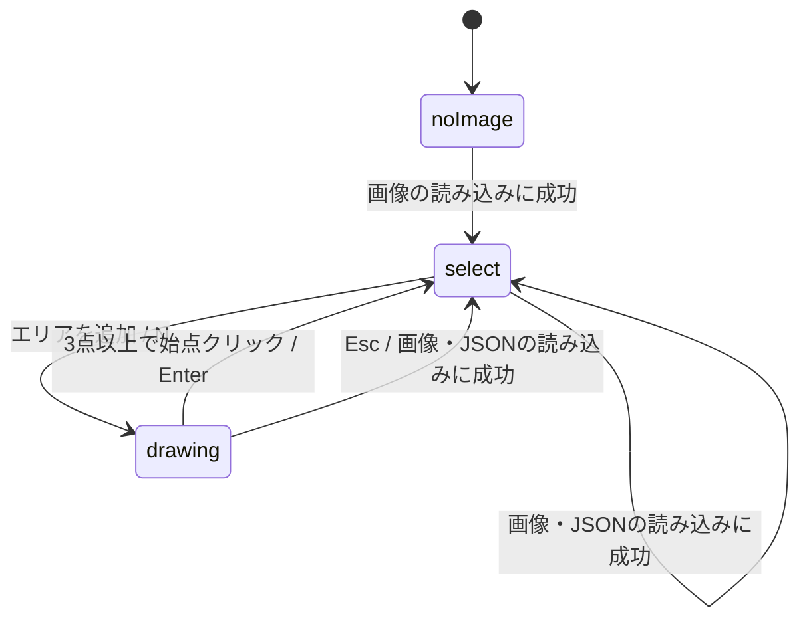

# プロジェクト用語集 (Glossary)

**更新日**: 2026-10-12

英字の見出しは、ドメイン用語・エラーではカナの読み（例: Result はリザルト、JSON はジェイソン）で五十音順に、技術用語・略語では英字を先にアルファベット順（大文字小文字を区別しない）に並べ、その後にカナの見出しを五十音順に並べる。

## ドメイン用語

### 当たり判定 (Hit Test)

- **定義**: マウスの位置が、どの頂点・辺・エリアの上にあるかを決める処理。距離は拡大率に関係なく画面px で測る
- **説明**: 優先順位は「選択中のエリアの頂点 > 選択中のエリアの辺 > エリアの内側 > 背景」。頂点と描画中の始点は 8画面px 以内、辺は 6画面px 以内で当たりとする。頂点と辺は、選択中のエリアのものだけを判定する
- **コード上の名前**: `hitVertex`・`hitEdge`・`hitArea`（`domain/hitTest.ts`）
- **関連用語**: 内外判定、頂点、辺

### エディタの状態 (Editor State)

- **定義**: ポリゴンエリア定義ツールが持つ、操作の結果に関わる全ての情報（画像、エリア、モード、選択、表示範囲、通知）
- **説明**: アプリケーションレイヤーの `reduce` だけが更新する。カーソル位置やドラッグ中の情報など、操作の結果に関わらない一時的な情報は含めず、UIレイヤーのコンポーネントが持つ
- **コード上の名前**: `EditorState`（`application/editorState.ts`）
- **関連用語**: 操作、モード、選択

### エリア (Area)

- **定義**: 1枚の画像の上に設定する、名前の付いた閉じたポリゴン1つ。頂点は3つ以上で、座標はピクセル座標で持つ
- **説明**: 名前は前後の空白を除いた値を保存し、1〜50文字（コードポイント数）で、同じ画像の中で一意。用途を強調するときは「判定エリア」と書いてもよい（カメラ画像で検知の判定に使うエリア）
- **コード上の名前**: `Area`（`domain/types.ts`）、`normalizeAreaName`・`validateAreaName`（`domain/area.ts`）
- **関連用語**: 頂点、表示色、エリア定義JSON
- **使わない表記**: 領域、ゾーン、リージョン

### エリア一覧 (Area List)

- **定義**: ツールの画面の右側にある、エリアの色・名前・頂点数の一覧。行のクリックで選択、名前のダブルクリックで名前の編集、「削除」でエリアの削除ができる
- **コード上の名前**: `AreaList`（`ui/AreaList.tsx`）
- **関連用語**: エリア、選択

### エリア定義JSON (Area Definition File)

- **定義**: ツールが出力・読み込みするJSONファイル。対象の画像の情報（ファイル名・幅・高さ）と、全てのエリアの名前と頂点を持つ
- **説明**: 形式のバージョンは `version: 1`。ファイル名は、画像のファイル名の最後の `.` から後ろを除き `.areas.json` を付けたもの（`.` を含まないか先頭の `.` だけのときは、そのまま `.areas.json` を付ける。例: `cam01.jpg` → `cam01.areas.json`）。表示色とツール内部の `id` は含めない。画像の幅・高さが今の画像と違うものは、MVP では読み込まない
- **コード上の名前**: `AreaDefinitionFile`（`domain/types.ts`）、`serialize`・`parse`・`checkCompatibility`・`definitionFileName`（`domain/definitionFile.ts`）
- **関連用語**: エリア
- **使わない表記**: 設定ファイル、エリアファイル

### エリア定義JSONの往復 (Round Trip)

- **定義**: 同じ画像を読み込んだ状態で、エリア定義JSONを出力 → 読み込み → 出力したとき、ファイルの内容が完全に一致すること
- **コード上の名前**: `application/roundtrip.integration.test.ts`
- **関連用語**: エリア定義JSON

### お知らせ (News)

- **定義**: トップページに日付の新しい順で表示する、会社からの短いお知らせ
- **説明**: 同じ日付のものは `id` の昇順で並べる。ツールの画面に出る「通知」とは別のもの
- **コード上の名前**: `News`、コンテンツコレクション `news`（`src/content/news.yaml`）
- **関連用語**: サイトコンテンツ

### 拡大率 (Scale)

- **定義**: 元画像の1px を画面の何画面px で表示するか。0.05〜32 の範囲
- **説明**: ホイールでは、1イベントごとに `1.2 ^ (-delta / 100)` 倍にする（マウスホイール1段階でおよそ1.2倍）。`delta` は `deltaY` を画面px に換算した値（換算は機能設計書の「拡大縮小」）。画面には `%` で表示する
- **コード上の名前**: `Viewport.scale`、`wheelZoomFactor`・`zoomAt`（`domain/viewport.ts`）、操作 `zoom`
- **関連用語**: 表示範囲、全体表示

### 確認ダイアログ (Confirm Dialog)

- **定義**: エリアがある状態で画像かエリア定義JSONを読み込むときに出す確認。文言は「エリアは全て消えます。よろしいですか？」
- **説明**: キャンセルしたら状態を変えない（描画中なら描画を続ける）
- **コード上の名前**: `window.confirm`（`PolygonAreaEditor` が出す）

### 画像座標 (Image Coordinates)

- **定義**: 元画像の左上を原点とする、小数を含む座標。拡大率や表示位置に左右されない
- **説明**: 画面座標から `screenToImage` で求める。整数に切り捨て（`floor`）たものがピクセル座標
- **コード上の名前**: `ImagePoint`（`domain/types.ts`。brand で画面座標と区別する）
- **関連用語**: ピクセル座標、画面座標

### 画像の情報 (Image Info)

- **定義**: 読み込んだ画像のファイル名・幅・高さ
- **コード上の名前**: `ImageInfo`（`domain/types.ts`）
- **関連用語**: エリア定義JSON

### 画面座標 (Screen Coordinates)

- **定義**: キャンバスの左上を原点とする、画面上の座標。単位は画面px
- **説明**: 当たり判定の距離と、拡大縮小の中心は画面座標で扱う
- **コード上の名前**: `ScreenPoint`（`domain/types.ts`。brand で画像座標と区別する）
- **関連用語**: 画像座標、画面px

### 画面px (Screen Pixel)

- **定義**: 画面上の長さの単位。CSS ピクセル（`devicePixelRatio` を掛けない値）
- **説明**: 当たり判定の距離（8画面px など）、頂点ハンドルの大きさ、線の太さは、拡大率に関係なく画面px で決める
- **関連用語**: 画面座標

### 技術メモ (Tech Note)

- **定義**: Markdown で書いてサイトに置く技術的なメモ（P2）。ブログではない
- **コード上の名前**: コンテンツコレクション `notes`（`src/content/notes/`）
- **関連用語**: サイトコンテンツ

### 既定の名前 (Default Name)

- **定義**: 新しいエリアに自動で付ける名前。`エリア{n}` の形で、`n` は既存の名前と重ならない最小の整数（1から）
- **コード上の名前**: `nextDefaultName`（`domain/area.ts`）
- **関連用語**: エリア

### キャンバス (Canvas)

- **定義**: ツールの画面で、画像とエリアを表示し、マウス操作を受け付ける部分。SVG で作る
- **説明**: HTML の `<canvas>` 要素は使わない。キャンバスの画面上の幅と高さ（画面px）は「キャンバスの大きさ」と書き、操作では `viewportSize`（型は汎用の `Size`）として渡す。大きさの決め方は機能設計書の「ポリゴンエリア定義ツールの画面構成」
- **コード上の名前**: `Canvas`（`ui/Canvas.tsx`）、`imageLoaded`・`fitToView` の `viewportSize`
- **関連用語**: 表示範囲

### 共通レイアウト (Base Layout)

- **定義**: 全ページで共通の `<head>`・ヘッダー・ナビゲーション・フッター
- **コード上の名前**: `BaseLayout`（`src/layouts/BaseLayout.astro`）

### サイトコンテンツ (Site Content)

- **定義**: リポジトリ内の YAML・Markdown で管理し、ビルド時にページへ埋め込むデータ。実績・お知らせ・ツール情報・技術メモ（P2）の4種類
- **説明**: 1件ごとの制約はスキーマで確かめ、満たさないとビルドが失敗する。id の一意性はユニットテストで確かめる
- **コード上の名前**: コンテンツコレクション（`src/content.config.ts`）
- **関連用語**: 実績、お知らせ、ツール情報、技術メモ

### 実績 (Achievement)

- **定義**: トップページに年の新しい順で表示する、会社としての活動の記録（デモ出展、講師、論文の実験支援など）
- **説明**: 同じ年のものは `order` の昇順（`order` のないものはその後）、それも同じなら `id` の昇順で並べる
- **コード上の名前**: `Achievement`、コンテンツコレクション `achievements`（`src/content/achievements.yaml`）
- **関連用語**: サイトコンテンツ

### 始点 (First Vertex)

- **定義**: 描画中のエリアで、最初に置いた頂点
- **説明**: 描画中の頂点が1つ以上あれば、始点の当たり判定を行う。始点をクリックすると、頂点が3つ以上ならエリアを確定し、2つ以下なら確定せず（頂点も追加せず）通知を出す。カーソルが始点の当たり判定に入ると、始点のハンドルを大きくして示す
- **関連用語**: 描画中、頂点

### ステータスバー (Status Bar)

- **定義**: ツールの画面の下部にある、カーソル位置のピクセル座標・拡大率・通知を表示する部分
- **コード上の名前**: `StatusBar`（`ui/StatusBar.tsx`）
- **関連用語**: 通知

### スラッグ (Slug)

- **定義**: ツールや技術メモを、URL・ファイル名・ディレクトリ名で識別する名前。小文字英数字とハイフンのみ
- **説明**: YAML には書かず、ファイル名（`[slug].yaml`・`[slug].md`）から決まる。ツールでは、ツール情報のファイル名、ツールのページのURL、ツールの実装のディレクトリ名に同じ値を使う（例: `polygon-area`）。`shared` は予約された名前で使えない。文書の中のプレースホルダーは `[slug]` と書く
- **コード上の名前**: `ToolInfo.slug`
- **関連用語**: ツール、ツール情報
- **使わない表記**: ツール名（`ToolInfo.name` を指す別の言葉のため）

### 全体表示 (Fit to View)

- **定義**: 画像全体がキャンバスに収まるように、拡大率と表示位置を戻す操作
- **説明**: 拡大率は `min(キャンバスの幅 / 画像の幅, キャンバスの高さ / 画像の高さ) × 0.95` を 0.05〜32 に収めた値で、画像をキャンバスの中央に置く。画像を読み込んだ直後も全体表示にする
- **コード上の名前**: `fitViewport`（`domain/viewport.ts`）、操作 `fitToView`
- **関連用語**: 拡大率、表示範囲

### 選択 (Selection)

- **定義**: 編集の対象として選ばれているもの。なし・エリア・頂点のいずれか
- **説明**: 頂点を選択している間も、その頂点のエリアを「選択中のエリア」として扱う
- **コード上の名前**: `Selection`（`application/editorState.ts`）
- **関連用語**: エディタの状態

### 操作 (Editor Action)

- **定義**: エディタの状態を変える出来事（頂点の追加、エリアの削除、拡大縮小など）を表すデータ
- **説明**: 機能設計書の「操作一覧」は、クリックやキー入力などのユーザーの入力の一覧で、`EditorAction` とは別のもの。1つのユーザーの入力から、0個以上の `EditorAction` が送られる
- **コード上の名前**: `EditorAction`（`application/editorState.ts`）
- **関連用語**: エディタの状態

### 操作説明 (Help Panel)

- **定義**: ツールの画面のツールバーの下に表示する、操作方法の説明。ボタンで開閉できる
- **コード上の名前**: `HelpPanel`（`ui/HelpPanel.tsx`）
- **関連用語**: ツールバー

### 頂点 (Vertex)

- **定義**: エリアのポリゴンを作る点。ピクセル座標で持ち、描いた順に並ぶ
- **説明**: 最後の頂点と最初の頂点を結んでポリゴンを閉じる。最初の頂点を末尾に重複して持たない。画面ではピクセルの中心に描く
- **コード上の名前**: `Point`、`Area.points`
- **関連用語**: 辺、ピクセル座標、頂点ハンドル
- **使わない表記**: ノード、コーナー

### 頂点ハンドル (Vertex Handle)

- **定義**: 選択中のエリアの頂点と、描画中の頂点に表示する、半径 5画面px の円。ドラッグで頂点を動かすための目印
- **説明**: 選択中の頂点のハンドルは、表示色で塗りつぶす。描画中の始点のハンドルは、カーソルが当たり判定に入ると半径 7画面px にする。選択していないエリアの頂点には表示しない
- **関連用語**: 頂点、選択

### 通知 (Message)

- **定義**: ステータスバーに表示する、エラーや操作の補足を伝える短い文
- **説明**: 5秒たつか、拡大縮小・移動・頂点のドラッグ以外の操作をすると消える。トップページの「お知らせ」とは別のもの
- **コード上の名前**: `Message`（`domain/types.ts`）、`EditorState.message`、`toMessage`（`domain/errors.ts`）
- **関連用語**: ステータスバー、エラー・例外の各項目

### ツール (Tool)

- **定義**: サイトで公開する、ブラウザ内だけで動くWeb便利ツール
- **説明**: 1つのツールは独立したディレクトリに置き、レイヤーに分ける（使わないレイヤーは省略できる）
- **コード上の名前**: `src/tools/[slug]/`
- **関連用語**: ツール情報、スラッグ、レイヤー
- **使わない表記**: アプリ、ユーティリティ

### ツール一覧 (Tool List)

- **定義**: 公開しているツールを `order` の昇順（同じ値なら slug の昇順）で並べたページ（`/tools/`）
- **コード上の名前**: `src/pages/tools/index.astro`
- **関連用語**: ツール情報

### ツール情報 (Tool Info)

- **定義**: ツール一覧に載せる、ツールの名前・説明・表示順
- **説明**: 1ツール1ファイルの YAML。ツールを追加するときは、このファイルを1つ足す
- **コード上の名前**: `ToolInfo`、コンテンツコレクション `tools`（`src/content/tools/[slug].yaml`）
- **関連用語**: ツール、ツール一覧

### ツールバー (Toolbar)

- **定義**: ツールの画面の上部にある、「画像を開く」「JSONを開く」「エリアを追加」「JSONをダウンロード」「全体表示」「操作説明」のボタンの並び
- **説明**: モードによって、押せないボタンがある（機能設計書の「ツールバーのボタンの有効・無効」）
- **コード上の名前**: `Toolbar`（`ui/Toolbar.tsx`）

### 内外判定 (Point in Polygon)

- **定義**: ある点がエリアの内側にあるかを決める処理。偶奇規則のレイキャスティングで判定する
- **説明**: 自己交差するエリアも、偶奇規則で判定する
- **コード上の名前**: `hitArea`（`domain/hitTest.ts`）
- **関連用語**: 当たり判定

### ピクセル座標 (Pixel Coordinates)

- **定義**: 元画像のピクセルの番号で表した整数の座標 `[x, y]`。`x` は 0〜幅-1、`y` は 0〜高さ-1
- **説明**: 画像座標を切り捨て（`floor`）て求める。カーソル位置の表示、頂点の位置、エリア定義JSONの座標は全てピクセル座標
- **コード上の名前**: `Point`、`toPixel`・`clampToImage`（`domain/viewport.ts`）
- **関連用語**: 画像座標、頂点

### 描画中 (Drawing)

- **定義**: 新しいエリアの頂点をクリックで置いていく途中のモード。3点以上で確定するとエリアになる
- **説明**: この用語はモードの意味に限って使う。画面に描くこと（レンダリング）は「表示」と書く
- **コード上の名前**: `EditorMode` の `drawing`
- **関連用語**: モード（状態・ステータスを参照）、始点

### 表示位置 (Offset)

- **定義**: 画像の原点（左上）を置く、キャンバス上の画面座標
- **コード上の名前**: `Viewport.offsetX`・`Viewport.offsetY`、操作 `pan`
- **関連用語**: 表示範囲

### 表示色 (Display Color)

- **定義**: エリアを見分けるための色。10色のパレットの番号で持つ
- **説明**: 新しいエリアには、使われている回数が最も少ない色のうち番号が最小のものを割り当てる。エリア定義JSONには出力せず、JSONを読み込んだときはエリアの順に割り当て直す
- **コード上の名前**: `Area.colorIndex`、`nextColorIndex`（`domain/area.ts`）
- **関連用語**: エリア

### 表示範囲（ビューポート）(Viewport)

- **定義**: キャンバスに画像をどの拡大率・表示位置で表示しているか。`画面座標 = 画像座標 × 拡大率 + 表示位置`
- **説明**: キャンバスの大きさ（`viewportSize`）とは別のもの
- **コード上の名前**: `Viewport`（`scale`・`offsetX`・`offsetY`）、`domain/viewport.ts`
- **関連用語**: 拡大率、表示位置、キャンバス、全体表示
- **使わない表記**: カメラ（カメラ画像と紛らわしいため）

### ファイルの振り分け (File Classification)

- **定義**: ボタンで選んだファイルとドロップしたファイルを、画像・エリア定義JSON・それ以外に分ける処理
- **説明**: `type` が `image/` で始まれば画像、名前が `.json` で終わる（大文字小文字を区別しない）か `type` が `application/json` ならJSON、それ以外はエラー
- **コード上の名前**: `classifyFile`（`domain/fileKind.ts`）

### 部品 (Component)

- **定義**: ページから渡されたデータを表示するだけの、サイトの Astro コンポーネント。コンテンツコレクションを直接読まない
- **コード上の名前**: `AchievementList`・`NewsList`・`ToolCard`（`src/components/`）

### 辺 (Edge)

- **定義**: エリアの隣り合う2つの頂点を結ぶ線分。最後の頂点と最初の頂点を結ぶ線分も含む
- **説明**: `i` 番目の辺は、`i` 番目の頂点から次の頂点までの線分。選択中のエリアの辺をダブルクリックすると、その位置に頂点を挿入する
- **コード上の名前**: `hitEdge` の戻り値、操作 `insertVertex` の `edgeIndex`
- **関連用語**: 頂点

### ポリゴンエリア定義ツール (Polygon Area Tool)

- **定義**: 画像を読み込み、ポリゴンでエリアを定義して、エリア定義JSONで出力するツール。ツールの第1弾
- **コード上の名前**: スラッグ `polygon-area`、ルートコンポーネント `PolygonAreaEditor`
- **関連用語**: エリア、エリア定義JSON
- **使わない表記**: アノテーションツール（アノテーションは対象外のため）

### Result（結果の型）

- **定義**: 成功（`ok: true` と値）か失敗（`ok: false` とエラー）のどちらかを表す型。想定内のエラーを、例外を投げずに返すために使う
- **コード上の名前**: `Result<T, E>`（`domain/types.ts`）
- **関連用語**: エラー・例外の各項目

### ルートコンポーネント (Root Component)

- **定義**: ツールのUIレイヤーの一番外側のコンポーネント。ツールのページから `client:only="preact"` で読み込む
- **説明**: エディタの状態を持ち、キーボード操作、ファイルの振り分け、確認ダイアログ、通知のタイマー、エリアの id の作成を担当する
- **コード上の名前**: `PolygonAreaEditor`（`ui/PolygonAreaEditor.tsx`）

### レイヤー (Layer)

- **定義**: ツールのコードを責務で分けた4つの層。UIレイヤーはアプリケーション・インフラ・ドメインに依存できる。アプリケーションレイヤーはドメインだけに、インフラレイヤーはドメインの型だけに依存する。アプリケーションとインフラは互いに依存しない
- **説明**:
  - **UIレイヤー**（`ui/`）: 画面の表示と操作の受付
  - **アプリケーションレイヤー**（`application/`）: エディタの状態を操作に応じて更新する
  - **インフラレイヤー**（`infrastructure/`）: PCのファイルの読み込みと保存、ローカルURLの作成と解放
  - **ドメインレイヤー**（`domain/`）: エリアの規則、幾何計算、JSON変換、エラーの型と文言
  - 詳細は [repository-structure.md](repository-structure.md) の「依存関係のルール」
- **コード上の名前**: `src/tools/[slug]/ui|application|infrastructure|domain/`
- **使わない表記**: サービス層、データ層

### ローカルURL (Object URL)

- **定義**: 読み込んだ画像ファイルを、サーバーに送らずにブラウザ内で表示するためのURL（`blob:` で始まる）
- **説明**: `URL.createObjectURL` で作り、画像を差し替えたときにUIレイヤーが古いURLを解放する
- **コード上の名前**: `EditorState.image.url`、`releaseImageUrl`（`infrastructure/files.ts`）

## 状態・ステータス

### 選択

| 値 | 意味 | 遷移の条件 |
|---|---|---|
| `none` | 何も選択していない | 初期状態。描画を始めたとき、背景のクリック、Escで解除したとき、選択中のエリアや頂点を削除したとき、画像・JSONの読み込みに成功したとき |
| `area` | エリアを選択中 | エリアの内側かエリア一覧の行をクリックしたとき、エリア一覧の名前をダブルクリックしたとき、描画を確定したとき（確定したエリアを選択） |
| `vertex` | 頂点を選択中（そのエリアも選択中として扱う） | 選択中のエリアの頂点をクリックまたはドラッグしたとき、辺に頂点を挿入したとき（挿入した頂点を選択） |

- **コード上の名前**: `Selection`（`kind`）

### 通知のレベル

| 値 | 意味 | 遷移の条件 |
|---|---|---|
| `info` | 操作の補足（例: 最初のファイルだけを読み込んだ） | 表示から5秒たつか、拡大縮小・移動・頂点のドラッグ以外の操作をすると消える |
| `error` | 操作が受け付けられなかった理由 | 同上 |

- **コード上の名前**: `Message.level`

### モード（エディタのモード）

| 値 | 意味 | 遷移の条件 |
|---|---|---|
| `noImage` | 画像が未読み込み | 初期状態。画像の読み込みに成功すると `select` へ |
| `select` | エリアの選択・編集ができる | 「エリアを追加」かNキーで `drawing` へ。画像の読み込みに成功するとエリアを全て消して `select` のまま。JSONの読み込みに成功するとエリアを置き換えて `select` のまま |
| `drawing` | 新しいエリアを描画中 | 3点以上で始点クリックかEnterで、エリアを確定して `select` へ。Escで中止して `select` へ。画像かJSONの読み込みに成功すると、中止して `select` へ。読み込みに失敗したとき、確認ダイアログでキャンセルしたときは `drawing` のまま |

- **コード上の名前**: `EditorMode`（`kind`）

## エラー・例外

エラーの型は全て `domain/errors.ts` に置き、`kind` で種類を区別する。表示する文言は `toMessage` で作る。

### エリア名が空

- **発生条件**: エリア名を、空（空白だけを含む）に変更しようとした。またはエリア定義JSONのエリア名が空
- **ユーザーへの表示**: 「名前を入力してください」（JSONの場合は「項目の誤り」）
- **対処**: 1文字以上の名前を入力する
- **コード上の名前**: `AreaNameError`（`{ kind: "empty" }`）

### エリア名が長すぎる

- **発生条件**: エリア名を51文字以上（コードポイント数）に変更しようとした
- **ユーザーへの表示**: 「名前は50文字以内にしてください」（JSONの場合は「項目の誤り」）
- **対処**: 50文字以内にする
- **コード上の名前**: `AreaNameError`（`{ kind: "tooLong" }`）

### エリア名の重複（JSONの読み込み時）

- **発生条件**: エリア定義JSONの中に、前後の空白を除くと同じになる名前のエリアが2つ以上ある
- **ユーザーへの表示**: 「エリア名「{name}」が重複しています」
- **対処**: JSONのエリア名を重ならないように直す
- **コード上の名前**: `DefinitionParseError`（`{ kind: "duplicateName"; name }`）

### エリア名の重複（名前の変更時）

- **発生条件**: 他のエリアと同じ名前に変更しようとした
- **ユーザーへの表示**: 「同じ名前のエリアがあります」
- **対処**: 別の名前にする
- **コード上の名前**: `AreaNameError`（`{ kind: "duplicate" }`）

### 確定時の頂点の不足

- **発生条件**: 描画中の頂点が2点以下で、エリアを確定しようとした（Enter、または始点のクリック）
- **ユーザーへの表示**: 「頂点を3つ以上置いてください」
- **対処**: 頂点を追加してから確定する
- **コード上の名前**: `EditOperationError`（`{ kind: "tooFewPointsToFinish" }`）

### 画像が未読み込みでのJSONの読み込み

- **発生条件**: 画像を読み込む前に、JSONをドロップした（「JSONを開く」ボタンは押せない）
- **ユーザーへの表示**: 「先に画像を読み込んでください」
- **対処**: 先に画像を読み込む
- **コード上の名前**: `FileDropError`（`{ kind: "imageRequiredFirst" }`）

### 画像サイズの不一致

- **発生条件**: エリア定義JSONの `image.width`・`image.height` が、読み込んでいる画像と違う
- **ユーザーへの表示**: 「画像のサイズが一致しません（JSON: {幅}×{高さ}、読み込んだ画像: {幅}×{高さ}）」
- **対処**: JSONを作ったときと同じ解像度の画像を読み込む
- **コード上の名前**: `DefinitionParseError`（`{ kind: "imageSizeMismatch"; json; image }`）

### 画像でもJSONでもないファイル

- **発生条件**: 選んだファイル・ドロップしたファイルが、画像（`type` が `image/` で始まる）でもJSON（名前が `.json` で終わる（大文字小文字を区別しない）、または `type` が `application/json`）でもない
- **ユーザーへの表示**: 「画像ファイル（PNG / JPEG / WebP など）またはエリア定義JSONを選んでください」
- **対処**: 画像かエリア定義JSONを選び直す
- **コード上の名前**: `FileDropError`（`{ kind: "unknownFileType" }`）

### 画像のデコードの失敗

- **発生条件**: 画像ファイルを表示用に読み込めなかった（ファイルの破損など）。デコードできても幅か高さが 0 のとき
- **ユーザーへの表示**: 「画像を読み込めませんでした。ファイルが壊れていないか確認してください」
- **対処**: ファイルを確認するか、別の形式で保存し直して読み込む
- **コード上の名前**: `ImageLoadError`（`{ kind: "decodeFailed" }`）

### 項目の誤り

- **発生条件**: エリア定義JSONで、最上位がオブジェクトでない、必須の項目がない、型が違う、値が規則を満たさない（`version` がない・数値でない、`image.width` が0、エリア名が空・51文字以上、頂点が2点以下、座標が整数でない など）
- **ユーザーへの表示**: 「{path} が正しくありません」（例: 「areas[1].points が正しくありません」）。最上位がオブジェクトでないときは「JSONの形式が正しくありません」
- **対処**: 示された場所を修正するか、ツールで出力し直す
- **コード上の名前**: `DefinitionParseError`（`{ kind: "invalidField"; path }`）

### 削除による頂点の不足

- **発生条件**: 頂点が3つのエリアから、頂点を削除しようとした
- **ユーザーへの表示**: 「エリアの頂点は3つ以上必要です」
- **対処**: 削除したい場合は、エリアごと削除する
- **コード上の名前**: `EditOperationError`（`{ kind: "minimumPointsRequired" }`）

### 座標の範囲外

- **発生条件**: エリア定義JSONの頂点が、画像の範囲（`0〜幅-1`、`0〜高さ-1`）の外にある
- **ユーザーへの表示**: 「{path} が画像の範囲外です」（例: 「areas[0].points[2] が画像の範囲外です」）
- **対処**: 示された頂点を範囲内に直す
- **コード上の名前**: `DefinitionParseError`（`{ kind: "pointOutOfRange"; path }`）

### JSONの形式の誤り

- **発生条件**: ファイルがJSONとして解釈できない
- **ユーザーへの表示**: 「JSONの形式が正しくありません」
- **対処**: ツールが出力したエリア定義JSONを選ぶ
- **コード上の名前**: `DefinitionParseError`（`{ kind: "invalidJson" }`）

### 対応していない形式の画像

- **発生条件**: 画像として振り分けたファイルの `type` が、`image/png`・`image/jpeg`・`image/webp`・`image/gif`・`image/bmp` のどれでもない（TIFF・HEIC・SVG など）
- **ユーザーへの表示**: 「対応していない画像の形式です。PNG / JPEG / WebP / GIF / BMP の画像を選んでください」
- **対処**: 対応している形式に変換してから読み込む
- **コード上の名前**: `ImageLoadError`（`{ kind: "unsupported" }`）

### 対応していないバージョン

- **発生条件**: エリア定義JSONの `version` が、数値で `1` 以外
- **ユーザーへの表示**: 「対応していないバージョンです（version: {JSONの値}）」
- **対処**: 対応しているバージョンで出力したJSONを使う
- **コード上の名前**: `DefinitionParseError`（`{ kind: "unsupportedVersion"; version }`）

### ファイルの読み込みの失敗

- **発生条件**: JSONファイルの中身を読めなかった
- **ユーザーへの表示**: 「ファイルを読み込めませんでした」
- **対処**: ファイルを確認して、もう一度読み込む
- **コード上の名前**: `FileReadError`（`{ kind: "readFailed" }`）

### 複数のファイルのドロップ（info の通知）

- **発生条件**: 2つ以上のファイルを一度にドロップした。エラーではなく、最初の1つだけを読み込む
- **ユーザーへの表示**: 読み込みに成功した後に、info「最初のファイルだけを読み込みました」
- **対処**: 他のファイルが必要なら、1つずつ読み込む
- **コード上の名前**: エラー型はなし（UIレイヤーが info の通知を出す）

### 予期しないエラー

- **発生条件**: 上のどれにも当たらない例外が、UIレイヤーのイベント処理で発生した
- **ユーザーへの表示**: 「予期しないエラーが発生しました」
- **対処**: 開発者はブラウザのコンソールで詳細を確認する。状態は例外の前のまま保たれる
- **コード上の名前**: なし（UIレイヤーで捕捉する）

## 技術用語

### Astro

- **定義**: サイト全体を静的HTMLとして生成するフレームワーク。コンテンツコレクション、アイランド、CSP の出力（`security.csp`）を使う
- **バージョン**: 7.3.8

### @astrojs/check

- **定義**: `.astro` ファイルも含めて型チェックするツール。`pnpm typecheck`（`astro check`）の実体
- **バージョン**: 0.9.10

### ESLint

- **定義**: lint のツール。typescript-eslint・eslint-plugin-astro と組み合わせ、レイヤーの依存のルールとネットワーク通信の禁止も確かめる
- **バージョン**: 10.12.0（typescript-eslint 8.71.1、eslint-plugin-astro 3.2.1）

### GitHub Actions

- **定義**: CI（`ci.yml`）と、GitHub Pages への公開（`deploy.yml`）を動かす仕組み
- **バージョン**: actions/checkout v7.0.1、jdx/mise-action v5.1.1、withastro/action v6.1.3、actions/deploy-pages v5.0.1

### GitHub Pages

- **定義**: サイトの公開先。最初は `https://yamadentanaka.github.io/yamaden_site/` で公開する。無料で使うため、リポジトリは公開にする
- **バージョン**: 該当なし

### mise

- **定義**: Node.js と pnpm のバージョンを `mise.toml` で管理するツール。手元では `mise install`、CI では jdx/mise-action で使う
- **バージョン**: 開発者の手元で入れた最新版

### Node.js

- **定義**: ビルドと開発ツールの実行環境
- **バージョン**: 24 LTS（24.21.0）

### Playwright

- **定義**: E2E テストのツール。Chromium で、ファイルの読み込み・ダウンロード・通信の監視・CSP の違反の確認を行う
- **バージョン**: 1.64.0

### pnpm

- **定義**: パッケージマネージャ
- **バージョン**: 12.11.2

### Preact

- **定義**: ツールのUIレイヤーで使う、React と同じ書き方の小さなUIライブラリ
- **バージョン**: 10.29.8

### Prettier

- **定義**: フォーマッタ。prettier-plugin-astro と組み合わせる。docs やエージェントの設定は整形しない
- **バージョン**: 3.9.10（prettier-plugin-astro 1.1.1）

### SVG (Scalable Vector Graphics)

- **定義**: ポリゴンエリア定義ツールで、画像とエリアを表示する方法。拡大縮小は SVG のグループに `transform` を当てて行う
- **バージョン**: 該当なし

### TypeScript

- **定義**: サイトとツールの実装言語。7 系への移行の条件は [architecture.md](architecture.md) を参照
- **バージョン**: 6.0.3

### Vitest

- **定義**: ユニットテスト・統合テストのツール
- **バージョン**: 5.0.3

### WebAssembly

- **定義**: ブラウザで Rust などのコードを動かす仕組み。計算が重いツールを作るときに使う候補（今は使わない）
- **バージョン**: 該当なし

### アイランド (Islands)

- **定義**: 静的なページの一部だけで JavaScript を動かす Astro の仕組み。ツールのルートコンポーネントを `client:only="preact"` で読み込む
- **バージョン**: Astro 7.3.8 の機能

### コンテンツコレクション (Content Collections)

- **定義**: サイトコンテンツを型付きで読み込み、ビルド時にスキーマで検証する Astro の仕組み。実績・お知らせは `file()` ローダー、ツール情報と技術メモ（P2）は `glob()` ローダーで読み込む
- **バージョン**: Astro 7.3.8 の機能

### 必須チェック

- **定義**: PR の前と CI で通す、テスト・lint・フォーマット確認・型チェック・ビルド・E2E テスト・JavaScript の大きさの確認。手元と CI でそれぞれ何を実行するかは [development-guidelines.md](development-guidelines.md) の「必須チェック」
- **バージョン**: 該当なし

### ベースパス (base)

- **定義**: サイトを置くURLのパス（`/yamaden_site/`）。Astro の `base` に設定し、サイト内のリンクは `withBase` で作る
- **説明**: 独自ドメインに移ったときは `/` に変える
- **コード上の名前**: `astro.config.mjs` の `base`、`withBase`（`src/routing/withBase.ts`）
- **バージョン**: Astro 7.3.8 の機能

## 略語・頭字語

| 略語 | 正式名称 | 意味 |
|---|---|---|
| CI | Continuous Integration | PR と `main` への push ごとに、テスト・lint・フォーマット確認・型チェック・ビルド・E2E テストを自動で行うこと |
| CSP | Content Security Policy | ページが読み込み・通信してよい先をブラウザに伝える仕組み。`connect-src 'none'` で通信を止める |
| DNS | Domain Name System | ドメイン名と公開先を結びつける仕組み。独自ドメインを使うときに CNAME を追加する |
| E2E | End to End | 実際のブラウザで画面を操作して確かめるテスト |
| JSON | JavaScript Object Notation | エリア定義の出力形式 |
| KPI | Key Performance Indicator | 成功を測る指標 |
| LTS | Long Term Support | 長期サポート版（Node.js 24 LTS） |
| MVP | Minimum Viable Product | 最初に公開する最小限の機能の範囲（PRD の P0） |
| P0 / P1 / P2 | Priority 0〜2 | PRD の機能の優先度。P0 は必須（MVP）、P1 は重要（初期リリース後すぐ）、P2 はできれば（将来検討） |
| PR | Pull Request | 変更を `main` に取り込むための依頼 |
| PRD | Product Requirements Document | プロダクト要求定義書（`docs/product-requirements.md`） |
| YAML | YAML Ain't Markup Language | サイトコンテンツ（実績・お知らせ・ツール情報）の記述形式 |
